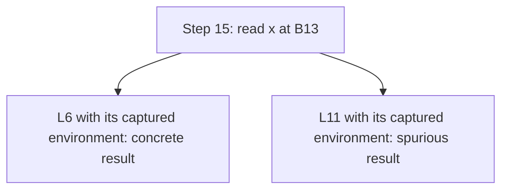

# A guided example: from CEK execution to abstract branching

Run the demonstration inside the pinned review environment:

```sh
opam exec -- dune exec bin/guided_example.exe
```

The executable prints Markdown computed from the real machine transitions.
The checked-in [generated trace](results/guided-example.md) contains every CEK
state, the abstract prefix up to its first choice, both successor states, and
the effect of garbage collection. Regenerate it together with its provenance
using `opam exec -- python3 scripts/run_experiments.py --milestones`.

## 1. Read the program before reading the machine

We use `Examples.repeated_calls`, already present in the experiment corpus.
Let `I = lambda x. x` and `K = lambda z. lambda w. z`. The source is:

```text
(lambda id.
   (lambda ignored. id K)
   (id I))
I
```

`I` and `K` abbreviate functions, not extra primitives or free variables. The
actual AST is closed. Call-by-value first evaluates `id I`, binds its result to
`ignored`, then evaluates `id K`. The name `ignored` is unused in that final
expression, but its argument is still evaluated. Both calls invoke the same
closure bound to `id`; the concrete result is `K`.

The generated trace labels syntax occurrences. `L13` is the shared identity
closure passed as `id`; `L11` is the separate identity expression used as its
first argument. They have the same source syntax but different labels. `L6`
is `K`. Each alias abbreviates the function listed in the opening table.

## 2. Follow the deterministic CEK trace

A CEK state is `(control, environment, continuation)`. Environments map names
directly to closures, each retaining its lexical environment. `Arg` remembers
an operand and its environment; `Fun` remembers the evaluated function closure.
`halt` means no work remains. The trace has 17 states and 16 transitions:

| Steps | What happens | Why it matters |
| --- | --- | --- |
| 0-3 | Evaluate the outer function and `L13`, then bind `id` | The shared identity is defined in the empty environment |
| 3-8 | Save the `ignored` function, then evaluate `id L11` | Call-by-value evaluates even this discarded argument |
| 8-10 | Bind `x` to `L11`, then look up `x` | Enter the identity's saved environment, extended with its parameter |
| 10-11 | Bind the first result to `ignored` | Restore the saved caller environment for the next application |
| 11-15 | Evaluate `id L6` and bind `x` to `L6` | A new invocation has a new concrete parameter binding |
| 15-16 | Look up `x` and finish with `L6` | Concrete execution has one next state and one result |

Captured environments are printed recursively. At step 9, `{x=L11{id=L13{}}}`
says that `x` denotes the first argument closure, created in an environment
containing `id`. Looking up `x` restores that closure's environment at step 10.
The current function's environment is not substituted for the argument's.

These transitions come from the four cases in `Cek.step`. The demonstration
reads `Cek.run`; it does not reimplement the evaluation rules.

## 3. Put the recursive structures behind addresses

The store machine changes the representation:

```text
CEK:    environment[x] = closure
Store:  environment[x] = address
        store[address] = {closure alternatives}
```

Continuations also live in the store, and the state carries their current
address. With `Fresh` allocation, the two calls get different addresses for
`x`, each containing one closure. Execution remains deterministic.

With `Site_based` allocation, both calls use `B13`, the binding site of the
shared lambda `L13`. `A` and `F` addresses hold argument and function frames;
their roles are disjoint from `B` addresses. The abstract table projects each
state to control, environment, continuation address, and store size. It does
not print the entire store at every step. Phase is always zero for sites.

## 4. Observe the exact point where the analysis branches

The abstract prefix remains deterministic up to step 15. At the first call's
lookup (step 9), `B13` contains only `L11`. Without GC, the cell remains after
the call returns. The second invocation adds `L6` instead of overwriting `L11`:

```text
first call:   store[B13] = {L11{id=B1}}
second call:  store[B13] = {L11{id=B1}, L6{id=B1; ignored=B3}}
```

At step 15, control is `x`, its environment maps `x` to `B13`, and the
continuation is `halt`. `Store_machine.raw_successors` reads every closure:



Both successors are final. They restore different captured environments while
keeping the store and continuation pointer. The `L11` result is spurious: the
concrete source returns `K`, not the first argument `I`. Address reuse has merged
information from two invocations.

The complete graph has 18 states: the 16-state prefix (0 through 15) and its two
final alternatives. This count comes from `Store_machine.analyze`, not from
stopping the display at its first choice. `prefix_until_choice` deduplicates
actual successors and stops before selecting a branch.

## 5. Turn on collection and repeat the computation

Collection follows every ordinary transition. After the first lookup returns
its argument closure, that invocation's `x` cell is no longer reachable. The
pending continuation retains what the second call needs, but not the completed
invocation's parameter binding.

GC removes `B13` before reuse. The second call recreates it with only `L6`, so
the lookup at step 15 has one successor. The generated trace shows the singleton
cells read at steps 9 and 15. The complete collected graph has 17 states and one
final state.

GC does not delete individual old alternatives from a still-live joined cell.
Here it removes the entire unreachable cell before reuse. Unused environment
entries can still mention removed addresses: roots are restricted to free
variables, so this does not imply a missing required value.

## 6. Checks and limits

`test/guided_example_checks.ml` checks that:

- The concrete result agrees with independent substitution evaluation and is `K`.
- The first abstract choice is a lookup of `x` at the shared identity binder.
- The two alternatives are exactly `I` and `K`, are reachable, are final, and
  restore their own captured environments.
- With GC, both calls use the same binder site, each read is singleton, and
  the complete graph has only the expected final syntax.

This isolates one source of imprecision and one GC precision gain. It does not
claim that site allocation is always precise or that GC removes every spurious
behavior. Final syntax counts omit captured environments; the tests also check
concrete values through reification and inspect actual abstract alternatives.

Read `lib/cek.ml`, `lib/store_machine.ml`, then `lib/guided_example.ml`. The
renderer in `bin/guided_example.ml` introduces no additional evaluation rules.
